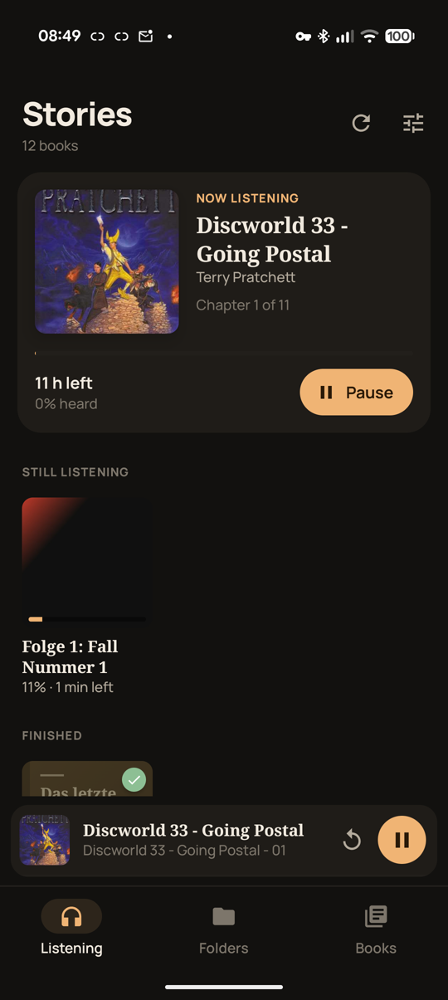
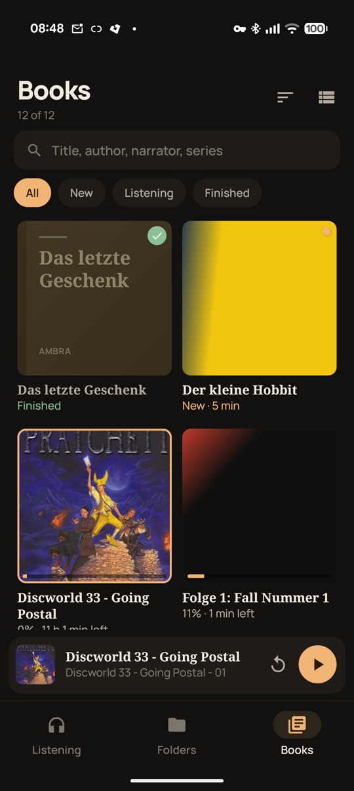
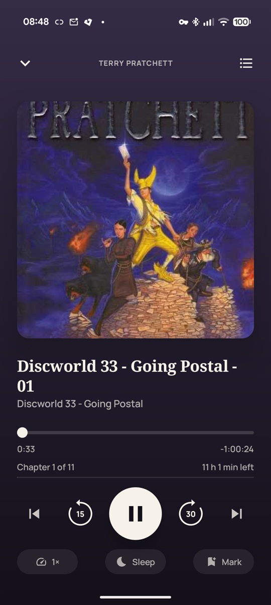

# Stories

Audiobook player for Android. Point it at a folder; each subfolder is a book,
a folder of books is a series.

<p>
  
  
  
</p>

- Remembers the position of every book, separately.
- Covers show what's new, in progress or finished.
- Reads tags and chapters (M4B, MP3, FLAC, Ogg, Opus, CUE). Disc folders
  (`CD1`, `CD2`) become one book.
- Wrong grouping? Join or split books and edit titles in the app. Your files
  are never changed.
- Imports positions from Smart AudioBook Player (`position.sabp.dat`).
- Optional: saves positions next to the books, so synced folders
  (Syncthing, Nextcloud) carry them to other devices.
- Sleep timer with adjustable fade-out (shake to extend), per-book speed,
  bookmarks, widget, Android Auto.
- Optional: delete books from the phone, with their covers and
  position files.

Needs Android 11+ and all-files access.

## Build

```sh
./gradlew assembleRelease   # signing: see SIGNING.md
```

## License

GPL-3.0. Manrope font: SIL Open Font License.
